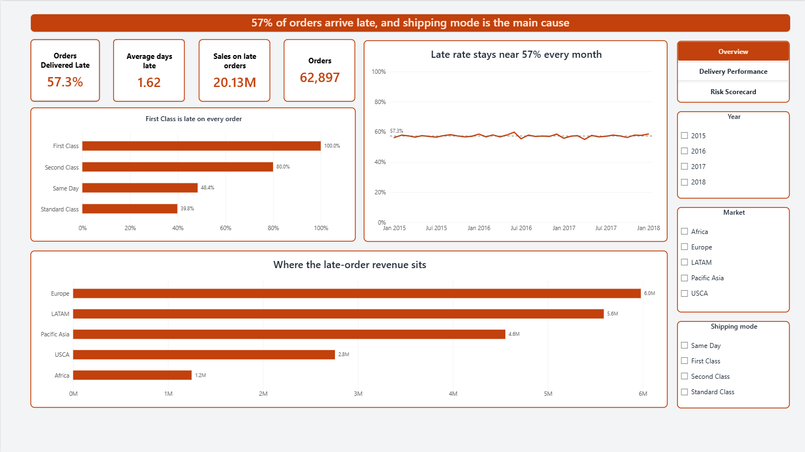
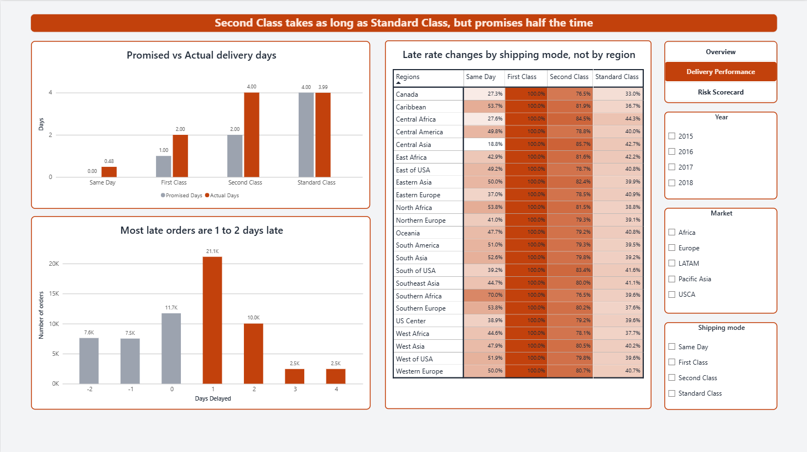
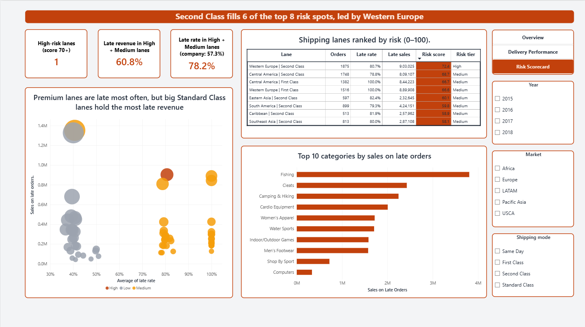
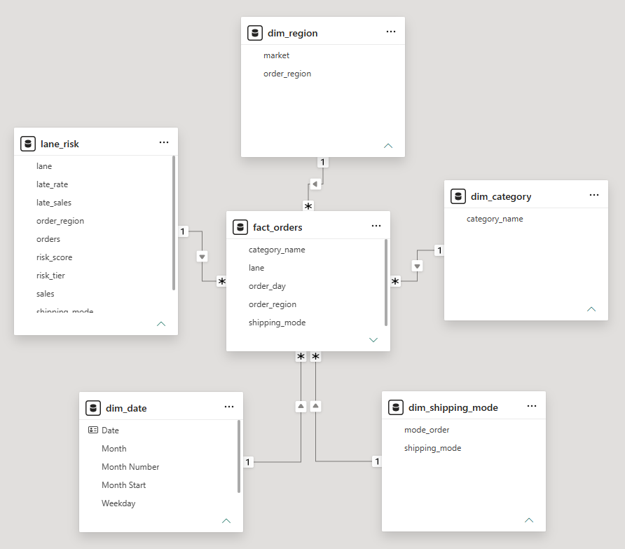

# Delivery Risk Analytics

Why do so many orders arrive late, and where should a company fix it first?

This project analyses a global retailer's order data to find the causes of late deliveries and how much revenue they put at risk. It runs end to end: data cleaning in Python, analysis in SQL Server, a risk score for every shipping lane, and an interactive Power BI dashboard.

**Tools:** Python (pandas, Matplotlib) · SQL Server · Power BI (DAX) · Docker

## Key findings

- **57.3% of orders arrive late**, by 1.62 days on average.
- **Shipping mode is the main cause.** First Class is late on 100% of orders and Second Class on 80%, compared with 40% for Standard Class. Together they account for 53.8% of all late orders.
- **The problem is the delivery promise, not the delivery speed.** First Class promises 1 day and always takes 2. Second Class promises 2 days but takes 4, the same as Standard Class. Customers paying for faster shipping get no faster delivery.
- **Location and product don't explain it.** Late rates stay in a narrow range across regions (52.6%–60.0%) and product categories (about 56%–60%).
- **57.2% of sales (20.1M of 35.2M) are on late orders.** Profit margin is almost the same for late and on-time orders (10.6% vs 11.0%), so the real cost is customer trust and revenue at risk.
- **Where to act first:** the High and Medium-risk shipping lanes, mostly Second and First Class, are late 78.2% of the time (vs 57.3% company-wide) and hold 60.8% of late-order revenue across scored lanes. The riskiest lane is Western Europe | Second Class.

## Recommendations

1. **Reset the delivery promise for Second Class** from 2 days to 4, or fix its transit so it is genuinely faster than Standard Class.
2. **Reset the First Class promise** from 1 day to 2, or move First Class orders to a faster carrier.
3. **Start with the High and Medium-risk lanes.** Fixing them covers about 61% of the late-order revenue in scored lanes.

## Dashboard

File: `PowerBI/Delivery_Risk_Dashboard.pbix` · [PDF version](PowerBI/Delivery_Risk_Dashboard.pdf) ·

| Page | What it shows |
| --- | --- |
| Overview | Late rate, revenue on late orders, monthly trend, late rate by shipping mode and market |
| Delivery Performance | Promised vs actual days by mode, region × mode heatmap, how many days late orders are |
| Risk Scorecard | Every shipping lane ranked by a 0–100 risk score, risk vs revenue scatter, top categories |
| Lane Detail | Drill-through page: right-click any lane to see its trend, categories and cities |

Built on a star schema (one order-line fact table with date, shipping mode, region and category lookup tables) and 20+ DAX measures.

## Dataset

**Download:** [DataCo Smart Supply Chain dataset on Kaggle](https://www.kaggle.com/datasets/shashwatwork/dataco-smart-supply-chain-for-big-data-analysis)

- After cleaning: 172,765 rows covering 62,897 orders, from January 2015 onwards
- Each row is one product in an order, so one order can have several rows
- The data file isn't in this repo because it's too large. Download it from the link above.

## How I built it

**Step 1: Data cleaning** (`Data_Cleaning/Data Cleaning.ipynb`)
Removed duplicates and empty or personal columns, converted dates, added "days late" and "late (yes/no)" columns, set cancelled orders aside, and checked the numbers made sense.

**Step 2: Exploratory analysis** (`EDA/EDA.ipynb`)
Looked at late deliveries by shipping mode, region, category, month and customer type, and compared promised vs actual delivery days.

**Step 3: SQL analysis** (`SQL/delivery_risk_analysis.sql`)
Loaded the clean data into SQL Server, built an order-level view, re-checked every Python finding (all matched), ranked shipping lanes with window functions, and tracked the monthly trend.

**Step 4: Risk score** (in SQL)
Scored every shipping lane from 0 to 100 on how often it's late (40%), how much revenue it affects (30%), how late its orders are (20%) and how many late orders lose money (10%).

**Step 5: Power BI dashboard** (`PowerBI/`)
Four pages with synced filters, page navigation and a drill-through to lane detail.

## Notes and limits

- The dataset has no supplier field, so risk is scored by shipping lane (region + shipping mode) instead of by supplier.
- The risk score weights are a judgement call; the ranking of the top lanes is the useful output, not the exact score.
- City names come from the source data, which stores many of them in Spanish.

---

**Ankit Jandial** · [LinkedIn](www.linkedin.com/in/ankit-jandial)
